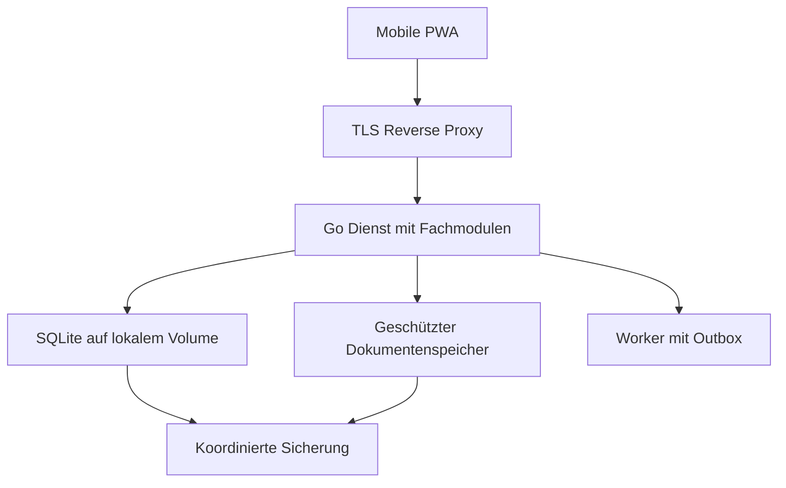

# DRK Warenbestand – Architektur-Blueprint v2

**Medizinprodukte, Sanitätsmaterial und mobile Einsatzbereitschaft**  
Version: 2.0 · Stand: 09.10.2026 · Ausgangspunkt: `mpbetreibv_inventory_microservice_blueprint.md`

## 1. Ziel und Architekturentscheidung

Die Anwendung verwaltet Medizinprodukte, Chargen, Lagerorte und Sollpacklisten für DRK-Bereitschaften. Sie unterstützt Betreiberpflichten durch vollständige Nachweise, nachvollziehbare Änderungen, Fristenüberwachung und lesbare Exporte. Die Software allein garantiert keine Gesetzeskonformität: Qualifikation, tatsächliche Prüfungen, Einweisungen und betriebliche Verfahren bleiben erforderlich.

**Entscheidung:** Ein modularer Dienst mit Go-Backend, eingebettetem PWA-Frontend, REST-API, SQLite und geschütztem Dokumentenspeicher. Für den Start werden weder mehrere Microservices noch ein Message Broker benötigt. Intern werden Authentifizierung, Geräteverwaltung, Materialverwaltung, Dokumente, Fristen und Benachrichtigungen als getrennte Module aufgebaut. Ein kleiner Worker im selben Prozess übernimmt wiederholbare Hintergrundaufgaben.

MVP: eine Betreiberorganisation pro Installation, mehrere Betriebsstätten und Lagerorte. Echte Mehrmandantenfähigkeit ist eine spätere Erweiterung mit eigener Sicherheitsprüfung. Benutzerberechtigungen können bereits auf Organisationseinheiten beschränkt werden.

## 2. Review des bisherigen Blueprints

Prioritäten: **P0** vor produktiver Nutzung; **P1** für einen belastbaren MVP; **P2** nach dem Pilotbetrieb; **P3** optionale Erweiterung.

| Kategorie | Befund im Ausgangsstand | Änderung in v2 | Priorität |
|---|---|---|---|
| Recht | Frühere Paragraphennummern; Bestandsverzeichnis auf Anlagen 1/2 verengt | § 14 für aktive nichtimplantierbare Produkte; § 13 für Medizinproduktebuch mit eigenem Anwendungsbereich | P0 |
| Recht | Anschaffungsjahr, Herstelleranschrift und betriebliche Zuordnung fehlen | Vollständige Bestandsfelder; Herstellungsjahr nur zusätzlich | P0 |
| Recht | Einweisungen und Inbetriebnahmebelege unvollständig | Eigene Einweisungsnachweise und nachvollziehbare Produktzuordnung | P0 |
| Recht | Gerätebeauftragter mit gesetzlichen Funktionen vermischt | Betreiber, lokale Zuständigkeit und Medizinproduktesicherheitsbeauftragter getrennt | P0 |
| Recht | Interne Defektmeldung ersetzt faktisch den Vorkommnisprozess | Gesonderter Melde- und Rückrufworkflow | P0 |
| Technik | Ein einzelnes Statusfeld vermischt Defekt, Fälligkeit und Quarantäne | Lebenszyklus, Sperrgründe und berechnete Fristen getrennt | P0 |
| Technik | Menge direkt in standortgebundener Charge | Charge, Standortbestand und Bewegungen getrennt; atomare Buchungen | P0 |
| Technik | Append-only als pauschale Revisionssicherheit dargestellt | Korrekturbuchungen, Dokumentversionen und unabhängige Sicherung | P1 |
| Technik | JWT, Rollen und Refresh-Token erhöhen MVP-Komplexität | Widerrufbare serverseitige Sessions; objektbezogene Rechte | P1 |
| Technik | WAL-Datenbank als problemlos kopierbare Einzeldatei beschrieben | SQLite-Backup-API plus konsistentes Dokumentmanifest und Restore-Test | P0 |
| Technik | Mobile Offline- und Konfliktsemantik fehlt | MVP online für Buchungen; veraltete Daten ausdrücklich gekennzeichnet | P1 |
| Betrieb | `.local` mit öffentlichem ACME und Beispielschlüssel | Reale DNS-Domain oder bewusst eingerichtete interne PKI; keine JWT-Secrets | P1 |

## 3. Rechtliche Anforderungen und Abgrenzung

### 3.1 Maßgebliche Fassung

Die Neufassung der MPBetreibV ist seit 20.02.2025 in Kraft; die geprüfte Gesamtausgabe nennt als letzte Änderung den 31.10.2025. Verweise des Ausgangsstands werden entsprechend aktualisiert. Quellenprüfung: 09.10.2026. [R1]

Die folgenden Anforderungen betreffen die einschlägigen Produkte und Betreiberkonstellationen. Ausnahmen werden je Produkt dokumentiert, nicht pauschal für eine Bereitschaft angenommen.

### 3.2 Bestandsverzeichnis – § 14 MPBetreibV

Das Verzeichnis umfasst **alle aktiven nichtimplantierbaren Produkte der jeweiligen Betriebsstätte**, nicht nur Produkte der Anlagen 1 und 2; gesetzliche Ausnahmen bleiben zu prüfen. Pflichtfelder: Bezeichnung, Art, Typ, Loscode oder Seriennummer, Anschaffungsjahr, Name/Firma und Anschrift des einschlägigen Herstellers beziehungsweise Bevollmächtigten oder gegebenenfalls Importeurs, betriebliche Identifikationsnummer soweit vorhanden, Standort und betriebliche Zuordnung. [R2]

Design: Verantwortliche Wirtschaftsakteure werden mit ihrer Funktion und einer historischen Anschrift gespeichert. CE-Kennzeichnung und MDR-Risikoklasse sind getrennte optionale Zusatzfelder; eine „CE-Klasse“ ersetzt kein Pflichtfeld. Herstellungsjahr ersetzt nicht Anschaffungsjahr. Seriennummern sind nicht über sämtliche Hersteller hinweg eindeutig.

Der Export enthält Betriebsstätte, Betreiber, Stichtag und alle Pflichtfelder. Elektronische Datenträger sind zulässig, wenn die Angaben zeitgerecht lesbar gemacht werden können. Ein besonderes „revisionssicheres PDF“ und eine Erzeugung in 500 ms sind keine Vorgaben dieser Vorschrift. [R2]

### 3.3 Medizinproduktebuch – § 13 MPBetreibV

Für Produkte der Anlagen 1 und 2 ist die Buchpflicht einschließlich der dort genannten Ausnahmen zu bewerten. Das Buch enthält Produktidentifikation, Belege zur Funktionsprüfung und Einweisung, beauftragte und eingewiesene Personen mit Einweisungszeitpunkt, Kontrollfristen und Ergebnisse, Instandhaltungen mit Ausführenden, Störungen beziehungsweise wiederholte gleichartige Bedienungsfehler samt Folgen sowie Meldungen an Behörden und Hersteller. Es muss Benutzern während der Arbeitszeit zugänglich sein und nach Außerbetriebnahme fünf Jahre aufbewahrt werden. [R3]

Design: Ein PDF-Anhang und ein generisches Audit-Log reichen als Datenmodell nicht aus. Es gibt strukturierte Fachereignisse, Einweisungen, Meldebezüge und einen vollständigen Buch-Export. Buchkorrekturen erfolgen durch ergänzende Einträge mit Bezug zum Ursprung. Außerbetriebnahme startet eine nachvollziehbare Aufbewahrungsfrist.

### 3.4 Einweisung, Qualifikation und Funktionsprüfung

Allgemeine Benutzeranforderungen und dokumentierte Einweisungen aktiver nichtimplantierbarer Produkte folgen aus § 4, unter Berücksichtigung der Ausnahmen. Gebrauchsanweisungen und sicherheitsbezogene Hinweise müssen zugänglich sein. Ein Benutzer muss sich vor der Verwendung vom ordnungsgemäßen Zustand und der Funktionsfähigkeit überzeugen. [R4]

Für einschlägige Produkte der Anlage 1 sind zusätzlich die Voraussetzungen und Belege nach § 11 abzubilden: Funktionsprüfung am Betriebsort, Einweisung der beauftragten Person und geeignete Benutzereinweisung. Sonderregelungen etwa für Laienprodukte sind gesondert zu bewerten. [R5]

Design: Eine App-Rolle ist kein Qualifikationsnachweis. Einweisung wird produkt- oder bauartbezogen mit belegter Übertragbarkeit, Unterweisendem, Person, Datum, Dokumentversion und Nachweis gespeichert. Ein Login darf fehlende Befähigung nicht in eine medizinische Nutzungsfreigabe umdeuten.

### 3.5 STK, MTK und weitere Kontrollen

| Kontrolle | Rechtsbezug | Fachliche Regel |
|---|---|---|
| STK | § 12 MPBetreibV | Einschlägigkeit prüfen; grundsätzlich spätestens zwei Jahre zum Monatsende nach Inbetriebnahme/letzter Kontrolle, gegebenenfalls früher wegen Einsatzbedingungen. Protokoll, Kennzeichnung und qualifizierte Durchführung berücksichtigen. [R6] |
| MTK | § 15 und Anlage 2 MPBetreibV | Produktspezifische Nachprüffrist; Beginn mit Ablauf des Inbetriebnahme-/Prüfjahres. Bei Anzeichen falscher Messung oder relevanten Eingriffen unverzügliche Kontrolle. [R7] |
| Elektrische Sicherheit | Anwendbare DGUV-Vorschrift und Arbeitsschutzregeln | Eigene fachliche Bewertung und Prüffrist. DGUV-Prüfung ersetzt nicht automatisch STK/MTK. Zuständigen Unfallversicherungsträger berücksichtigen. [R9] |
| IT-Sicherheit bestimmter Produktsoftware | § 17 MPBetreibV, soweit anwendbar | Eigener Regeltyp für einschlägige Software; konkrete Anwendbarkeit und aktuelle Anforderungen vor Regelaktivierung fachlich bestätigen. Nicht pauschal auf jedes Inventarprogramm übertragen. [R1] |
| Wartung/sonstige Prüfungen | Herstellerangaben und einschlägige Betreiberpflichten | Separate Wartungs-, Batterie-, Zubehör- und Funktionsprüfungsregeln; kein universelles Monatsintervall |

Beispiel aus Anlage 2: nichtinvasive Blutdruckmessgeräte haben grundsätzlich eine Nachprüffrist von zwei Jahren, Infrarot-Strahlungsthermometer von einem Jahr. Ausnahmen von Buchpflicht und MTK-Pflicht sind unabhängig voneinander zu prüfen. [R8]

**AED-Sonderfall:** § 12 enthält eine bedingte STK-Ausnahme für selbsttestende, für Laien vorgesehene AED mit regelmäßiger Sichtprüfung. Für neu ab 01.01.2027 in Betrieb genommene einschlägige AED gelten zusätzliche Voraussetzungen zur dokumentierten Fernüberwachung sowie weitere Vorgaben. Keine automatische Ausnahme allein anhand der Bezeichnung „AED“. Nachweise und Anwendbarkeit müssen hinterlegt werden. [R6]

### 3.6 Betreiber, Sicherheitsbeauftragter und Meldungen

Die rechtlich verantwortliche Betreiberorganisation, die Betriebsstätte und lokale Geräteverantwortliche werden separat erfasst. Der Beauftragte für Medizinproduktesicherheit nach § 6 ist eine eigene Funktion: Bei Gesundheitseinrichtungen mit regelmäßig mehr als 20 Beschäftigten sind Bestellung, Aufgaben und veröffentlichte Funktions-E-Mail zu beachten. Die konkrete Einordnung einer DRK-Einrichtung und ihrer Beschäftigten ist organisatorisch zu klären. [R10]

Ein mutmaßlich schwerwiegendes Vorkommnis benötigt einen eigenen Prozess. § 3 MPAMIV verlangt für die dort erfassten beruflichen/gewerblichen Betreiber und Anwender eine unverzügliche Meldung an die zuständige Bundesoberbehörde. Eine interne E-Mail oder eine Nachricht an den Hersteller ersetzt diese Meldung nicht. [R11]

Design: Meldungsstatus `ASSESSMENT_REQUIRED`, `REPORT_PENDING`, `REPORTED`, `FOLLOW_UP`, `CLOSED`; Behördenreferenz, Zeitpunkt, Verantwortlicher und Herstellerkontakt werden erfasst. Der Prozess darf die externe unverzügliche Meldung nicht durch eine interne Freigabeschleife verzögern. Patientenbezogene Details verbleiben im dafür vorgesehenen geschützten Fachverfahren; das Inventarsystem hält eine Referenz.

Rückrufe und Sicherheitskorrekturmaßnahmen erhalten betroffene Produkt-/Chargen-/Serienbereiche, Quellenbeleg, Sperrstatus, Standorttreffer und Maßnahmenabschluss. Verfügbare Ware kann systemweit gesperrt werden; der physische Verbleib bleibt nachvollziehbar.

### 3.7 Verbrauchsmaterial und ergänzende Bereiche

FEFO ist eine gewählte Lagerstrategie, keine pauschale eigenständige gesetzliche Pflicht unter der Bezeichnung „EU-MDR/FEFO“. Zu beachten sind produktspezifische Verwendbarkeit, Herstellerangaben, Lagerbedingungen und Verpackungszustand. Das System unterscheidet Verfallsdatum, gegebenenfalls Mindesthaltbarkeitsdatum, Anbruchfrist und unbekannte Datumsangaben.

Wiederverwendbare und aufbereitete Produkte benötigen bei Aufnahme in den Projektumfang einen eigenen Aufbereitungsprozess nach den einschlägigen Anforderungen, insbesondere §§ 8/9 MPBetreibV; der MVP ersetzt kein Aufbereitungs-QM. Arzneimittel, Betäubungsmittel, medizinische Gase, IVD/Laborprozesse und PSA werden als eigene Produktkategorien markiert. Vor ihrer fachlichen Freigabe müssen zusätzliche Regeln geprüft werden; die allgemeine Materialverwaltung belegt diese nicht automatisch.

Die Zweckbestimmung der Anwendung bleibt administrative Lager- und Nachweisverwaltung. Bei Erweiterung um patientenbezogene Diagnose-/Therapieentscheidungen oder Gerätesteuerung ist die regulatorische Softwarequalifikation erneut zu prüfen. Das ist eine Projektabgrenzung, keine endgültige Produktklassifizierung. [R14]

### 3.8 Datenschutz und IT-Sicherheitsrecht

Für Benutzerkonten, Einweisungen, Prüferangaben und Protokolle sind Verarbeitungszweck und Rechtsgrundlage zu dokumentieren. Informationspflichten, Datenminimierung, Löschfristen und Betroffenenrechte werden organisatorisch umgesetzt; gesetzlich benötigte Nachweise bleiben während ihrer Aufbewahrungsfrist verfügbar. Externe Dienstleister werden auf Auftragsverarbeitung und Übermittlungen geprüft. Ein Verzeichnis der Verarbeitungstätigkeiten wird geführt, soweit erforderlich. [R12]

Technische und organisatorische Maßnahmen umfassen Zugriffsschutz, geeignete Verschlüsselung, Verfügbarkeit, Wiederherstellung und regelmäßige Wirksamkeitsprüfung. Ein Datenschutzvorfall hat einen eigenen Bewertungsprozess; bei einschlägiger Meldepflicht gilt grundsätzlich die 72-Stunden-Regel gegenüber der Aufsichtsbehörde. [R13]

IP-Adressen sind im fachlichen Audit standardmäßig nicht gespeichert. Sicherheitslogs haben eine gesonderte, kurze und begründete Aufbewahrung. Namen werden nicht unnötig in jeder technischen Logzeile vervielfältigt. Eine dokumentierte Zuordnung von Akteur-ID und rechtlich benötigter Identität erhält die Nachweisbarkeit.

„IT-SiG“ ist keine pauschale Rechtsgrundlage für dieses System. BSIG-/NIS2-/KRITIS- und weitere Sicherheitsanforderungen werden abhängig von Betreiber, Einrichtung, Größe und Tätigkeit separat auf Anwendbarkeit geprüft. Daraus wird ohne diese Prüfung keine generelle Verpflichtung abgeleitet.

## 4. Systemaufbau und Betriebsgrenzen



- Eine App-Instanz und ein Worker mit eindeutiger Jobausführung. Keine parallelen schreibenden App-Replikate auf derselben SQLite-Datei.
- SQLite liegt auf einem lokal eingebundenen Dateisystem mit geeigneter Sperrsemantik, nicht auf einem gemeinsam genutzten NFS-/SMB-Volume.
- `foreign_keys=ON` je Verbindung, WAL, konfiguriertes Busy-Timeout; für haltbare Buchungen `synchronous=FULL`. Kurze Schreibtransaktionen und kontrollierte Writer-Konkurrenz.
- Versionierte Migrationen; vor Migration Backup, nach Migration Integritätsprüfung. Schemaänderungen sind keine unkontrollierten Startup-Nebeneffekte.
- SSE nur für aktualisierte Anzeigen. Reconnect lädt einen aktuellen Stand; Ereignisse allein sind keine Buchungsquelle.
- PostgreSQL wird bei mehreren schreibenden Instanzen, mehreren unabhängigen Mandanten oder gemessenen Schreibengpässen neu bewertet.

## 5. Authentifizierung und Berechtigungen

### 5.1 Sessions

Der MVP nutzt einen zufälligen, opaken Sitzungsschlüssel mit mindestens 256 Bit Entropie. Der Browser erhält ausschließlich das Cookie `__Host-session` mit `Secure`, `HttpOnly`, `Path=/` und ohne Domain-Attribut. `SameSite=Lax` erleichtert spätere OIDC-Weiterleitungen. Schreibzugriffe verlangen zusätzlich CSRF-Token und Origin-Prüfung.

Die Datenbank speichert nur einen kryptografischen Hash des hochentropischen Sitzungsschlüssels. Argon2id wird für Passwörter verwendet; für zufällige Sitzungstoken ist kein langsamer Passwort-Hash erforderlich. Login erzeugt eine neue Sitzung; Logout, Kontosperre und kritische Berechtigungsänderung widerrufen Sitzungen. Vorschlag: 8 Stunden absolute Laufzeit, 30 Minuten Inaktivität; eine längere mobile Sitzung ist eine explizite Betreiberentscheidung.

Rate-Limits gelten für Login, Recovery, Uploads und aufwendige Exporte. MFA ist für administrative Konten vorgesehen. Optionales OIDC nutzt Authorization Code mit PKCE, `state`, `nonce` und strikter Redirect-Prüfung. Kontoverknüpfung über stabile IdP-Kennung, nicht allein über eine ungeprüfte E-Mail-Adresse.

### 5.2 Rechte statt Rollenvererbung

| Rolle | Berechtigungen | Begrenzung |
|---|---|---|
| Viewer | Zulässige Bestände und Packlisten lesen | Keine Buchungen |
| Helfer | Scannen, Entnahme/Check buchen, Defekt melden | Keine Prüfbestätigung oder Entsperrung |
| Materialwart | Eingang, Umlagerung, Inventur, Materialquarantäne | Keine fachliche Gerätefreigabe allein durch diese Rolle |
| Geräteverantwortlicher | Geräteakten, Einweisungs-/Prüfnachweise, technische Sperren bearbeiten | Fachliche Qualifikation und betrieblicher Auftrag gesondert erforderlich |
| Leitung/Auditor | Betriebsstättenbezogene Exporte und Nachweise lesen | Auditzugriff ausdrücklich vergeben |
| Administrator | Benutzer, Konfiguration und Betrieb | Keine automatische Qualifikation als Prüfer oder gesetzlicher Beauftragter |

Mehrere Rollen pro Person sind möglich. Jeder API-Zugriff prüft Aktion **und** zulässigen Objektbereich, einschließlich Anhängen und Exporten. Ein QR-Code gewährt keine Rechte. Berechtigungen werden serverseitig geprüft und nicht aus einem lang gültigen Rollen-Token übernommen.

## 6. Fachliches Datenmodell

IDs sind stabile UUIDs; Zeitstempel UTC, fachliche Tagesfristen nach Betreiberzeitzone `Europe/Berlin`. Datumswerte werden strikt validiert. Organisations- und Gerätehistorie bleibt auch bei Benutzerdeaktivierung nachvollziehbar.

| Entität | Wesentliche Inhalte und Regeln |
|---|---|
| `operators`, `sites`, `org_units` | Rechtlicher Betreiber, Anschrift, Betriebsstätte und betriebliche Zuordnung |
| `users`, `role_assignments`, `sessions` | Konten, bereichsbezogene Rechte, widerrufbare Sitzungen |
| `locations` | Hierarchie, Betriebsstätte, stabiler QR-Code; Zyklen verboten, Elternwechsel geprüft |
| `economic_actors` | Hersteller/Bevollmächtigter/Importeur mit Anschrift; historische Snapshots bei Aktenänderungen |
| `device_models`, `devices` | Bezeichnung, Art, Typ, Anschaffungsjahr, Serien-/Losnummer, Inventarnummer, Standort, Zuordnung, In-/Außerbetriebnahme, Buch-/Kontrollpflichtbewertung |
| `device_events` | Inbetriebnahme, Prüfung, Wartung, Störung, Bedienungsfehler, Sperre, Freigabe, Korrektur und Außerbetriebnahme |
| `instructions` | Eingewiesene Person, Unterweisender, Produkt/Bauart, Datum, Gebrauchsanweisungsversion und Nachweis |
| `inspection_rules` | Kontrolltyp, Anwendbarkeit, Fristlogik, Grundlage, gültig ab/bis, bestätigende Person und Version |
| `inspections` | Durchführung, Prüfer/Firma, Ergebnis, Messverfahren/-werte beziehungsweise Protokollreferenz, nächste berechnete Frist |
| `product_types`, `product_identifiers` | Artikel, Kategorie, Basiseinheit, Packungsumrechnung, REF/PZN/GTIN/UDI sofern vorhanden |
| `batches` | Artikel, Herstellercharge, Original-Verfallsangabe, Präzision, normalisierter Grenztag, Herkunft und globale Sperren |
| `stock_balances` | Menge je Charge, Standort und lokalem Verwendbarkeitsstatus; Standortbezogener Lager-/Verpackungsschaden möglich |
| `stock_movements`, `movement_lines` | Unveränderbare Eingang-, Entnahme-, Transfer-, Inventur- und Stornobuchungen mit Bewegungszeilen |
| `packlist_versions`, `packlist_items` | Versionierte Sollmengen, Mindestrestlaufzeit, verpflichtende Geräte/Zubehör und genehmigte Alternativen |
| `readiness_checks` | Prüfer, Zeitpunkt, Sollversion, Datenstand, physische Sichtprüfung und festgestellte Abweichungen |
| `recalls`, `incidents` | Betroffener Bereich, Sperren, Maßnahmen, Meldereferenzen und Abschluss |
| `documents`, `document_links` | Unveränderliche Version, SHA-256, Größe, MIME, Speicher-ID, fachlicher Bezug und Aufbewahrung |
| `audit_events`, `outbox`, `idempotency_keys` | Änderungsnachweis, zuverlässige Benachrichtigung, Schutz vor Doppelbuchung |

**Validierung:** Keine globale Unique-Bedingung allein auf Seriennummer. Geräteidentifikation wird aus Hersteller/Modell/Serien- oder Losnummer plausibilisiert, während die lokale Inventarnummer eindeutig bleibt. Material ohne Herstellercharge oder Verfall ist zulässig, wenn dies fachlich begründet ist; „unbekannt“ ist von „nicht zutreffend“ zu unterscheiden. Ungeklärte kritische Angaben verhindern eine positive Einsatzbereitschaft.

### 6.1 SQL-Kern für Buchungsintegrität

Folgender Ausschnitt ist eine ausführbare Schema-Skizze für den Buchungskern, kein vollständiges Produktionsschema. Die weiteren Entitäten der Tabelle werden in versionierten Migrationen ergänzt.

```sql
PRAGMA foreign_keys = ON;
PRAGMA journal_mode = WAL;
PRAGMA synchronous = FULL;
PRAGMA busy_timeout = 5000;

CREATE TABLE batches (
  id TEXT PRIMARY KEY,
  product_id TEXT NOT NULL,
  lot_number TEXT,
  expiry_date TEXT,
  expiry_precision TEXT NOT NULL
    CHECK (expiry_precision IN ('DAY','MONTH','UNKNOWN','NOT_APPLICABLE')),
  global_state TEXT NOT NULL DEFAULT 'AVAILABLE'
    CHECK (global_state IN ('AVAILABLE','QUARANTINED','RECALLED'))
);

CREATE TABLE stock_balances (
  batch_id TEXT NOT NULL REFERENCES batches(id),
  location_id TEXT NOT NULL,
  local_state TEXT NOT NULL DEFAULT 'AVAILABLE'
    CHECK (local_state IN ('AVAILABLE','QUARANTINED','DAMAGED')),
  quantity INTEGER NOT NULL CHECK (quantity >= 0),
  version INTEGER NOT NULL DEFAULT 0 CHECK (version >= 0),
  PRIMARY KEY (batch_id, location_id, local_state)
);

CREATE TABLE stock_movements (
  id TEXT PRIMARY KEY,
  operation TEXT NOT NULL CHECK (operation IN
    ('RECEIPT','CONSUME','TRANSFER','ADJUSTMENT','REVERSAL','DISPOSAL')),
  actor_id TEXT NOT NULL,
  occurred_at TEXT NOT NULL,
  recorded_at TEXT NOT NULL,
  reason TEXT,
  reverses_id TEXT REFERENCES stock_movements(id),
  UNIQUE (reverses_id)
);

CREATE TABLE movement_lines (
  movement_id TEXT NOT NULL REFERENCES stock_movements(id),
  line_no INTEGER NOT NULL,
  batch_id TEXT NOT NULL REFERENCES batches(id),
  location_id TEXT NOT NULL,
  local_state TEXT NOT NULL,
  delta INTEGER NOT NULL CHECK (delta <> 0),
  PRIMARY KEY (movement_id, line_no)
);

CREATE TABLE idempotency_keys (
  actor_id TEXT NOT NULL,
  operation TEXT NOT NULL,
  request_key TEXT NOT NULL,
  request_hash TEXT NOT NULL,
  response_json TEXT NOT NULL,
  created_at TEXT NOT NULL,
  PRIMARY KEY (actor_id, operation, request_key)
);

CREATE TRIGGER movements_no_update BEFORE UPDATE ON stock_movements
BEGIN SELECT RAISE(ABORT, 'append-only'); END;
CREATE TRIGGER movements_no_delete BEFORE DELETE ON stock_movements
BEGIN SELECT RAISE(ABORT, 'append-only'); END;
CREATE TRIGGER lines_no_update BEFORE UPDATE ON movement_lines
BEGIN SELECT RAISE(ABORT, 'append-only'); END;
CREATE TRIGGER lines_no_delete BEFORE DELETE ON movement_lines
BEGIN SELECT RAISE(ABORT, 'append-only'); END;
```

Im Produktionsschema sind `product_id` und `location_id` Fremdschlüssel; gültige Datumswerte, Statuswerte der Bewegungszeilen und konsistente Verfallspräzision werden zusätzlich geprüft. Mengen werden ganzzahlig in kleinsten definierten Basiseinheiten geführt. Packungsumrechnungen sind explizit, nicht aus Barcode oder Artikelnamen geraten.

### 6.2 Atomare Bestandsbuchung

1. Rechte, Idempotenzschlüssel und Request-Hash prüfen.
2. `BEGIN IMMEDIATE`; bei bereits abgeschlossenem identischem Request die gespeicherte Antwort zurückgeben, bei abweichender Nutzlast `409 Conflict`.
3. Quellbestand nur mit `quantity >= requested`, erwarteter Version und aktuell zulässigem Status abbuchen; genau eine geänderte Zeile verlangen.
4. Zielbestand, Bewegungszeilen, Audit, Outbox und gespeicherte Antwort in derselben Transaktion schreiben.
5. `COMMIT`; bei Fehler vollständiges Rollback. Transfer muss mengenmäßig je Charge ausgeglichen sein.

Bei parallelen Entnahmen kann nie ein negativer Bestand entstehen. Korrekturen erfolgen über Gegenbuchung und gegebenenfalls Neubuchung; historische Bewegungen werden nicht überschrieben. Eine Inventur speichert Zählstand, Basisversion und Differenz. Zwischenzeitliche Bewegungen erzwingen einen neuen Abgleich.

## 7. Fristen, Sperren und Einsatzbereitschaft

### 7.1 Getrennte Zustandsdimensionen

- Lebenszyklus: `IN_SERVICE`, `OUT_OF_SERVICE`, `DISPOSED`.
- Aktive Sperren: Defekt, Rückruf, Prüfversagen, Quarantäne, fehlende Inbetriebnahmebelege, Aufbereitungsbedarf.
- Fristen: `NOT_APPLICABLE`, `UNKNOWN`, `CURRENT`, `DUE_SOON`, `OVERDUE`, jeweils pro Kontrolltyp.

Die angezeigte Einsatzbereitschaft wird daraus berechnet. Eine fällige Kontrolle entfernt keinen Defekt; ein bestandenes STK-Ergebnis hebt einen Rückruf nicht auf. Freigaben schließen ausdrücklich benannte Sperrgründe und erfordern die dafür festgelegte Berechtigung.

### 7.2 Fristenberechnung

Die Regelengine enthält `MONTH_END_AFTER_INTERVAL`, `YEAR_END_AFTER_INTERVAL`, `EXACT_DATE` und anlassbezogene Sofortfälligkeit. Jede Berechnung speichert Basisdatum, Regelversion, Rechts-/Herstellergrundlage und Ergebnis. Manueller Override verlangt Begründung und Nachweis; er darf die einschlägige Höchstfrist nicht stillschweigend verlängern.

Beispiele zur Verifikation: STK am 15.03.2026 mit zulässigem Zweijahresintervall → 31.03.2028; MTK im Jahr 2026 mit Zweijahresfrist → 31.12.2028. Kürzere fachlich festgelegte Fristen und notwendige Anlasskontrollen werden gesondert angewendet. [R6, R7]

Der Worker erzeugt Erinnerungen beispielsweise 60/30/7 Tage vor Fälligkeit. Diese Schwellen sind Betreiberkonfiguration. Ein E-Mail-Ausfall verändert keine Frist. Dashboard, Eskalation und Outbox bleiben verfügbar. Fachliche Datumsgrenzen werden auch beim Lesen und Buchen berechnet, sodass ein ausgefallener Nachtjob keine abgelaufene Ware freigibt.

### 7.3 Material und FEFO

FEFO berücksichtigt nur verfügbare, freigegebene, ausreichend haltbare Bestände am zulässigen Standort. Abgelaufene, zurückgerufene, beschädigte oder ungeklärte kritische Ware zählt nicht als nutzbarer Sollbestand. Gleiche Verfallsdaten werden deterministisch nach Eingang und ID sortiert.

Originalangabe und Datumspräzision bleiben erhalten. Monatliche Kennzeichnungen werden nach bestätigter Hersteller-/Produktregel normalisiert. Anbruch kann eine kürzere Nutzungsdauer erzeugen. Lagerverletzungen betreffen den tatsächlichen Standortbestand, nicht zwangsläufig jede Einheit einer Herstellercharge.

### 7.4 Kofferprüfung

Der Check zeigt physische Menge, nutzbare Menge, Sollabweichung, Restlaufzeit, Gerätesperren, fällige Kontrollen und letzten manuellen Prüfnachweis. Grün setzt aktuelle Daten und die erforderlichen physischen Checks voraus. Datenbankvollständigkeit allein belegt weder Verpackungsintegrität noch Funktionsfähigkeit. Jede Ampel nennt ihre Gründe und den Datenstand.

## 8. Dokumente und nachvollziehbare Änderungen

Dateien werden über zufällige Speicher-IDs abgelegt; Pfade und Originalnamen werden nicht vom Client als Dateisystempfad übernommen. Größenlimit, erlaubte Dateitypen, MIME-/Signaturprüfung und Quarantäneprüfung begrenzen Uploadrisiken. Downloads laufen durch autorisierte API-Endpunkte, bevorzugt als Attachment mit `nosniff`; keine öffentliche `/attachments`-Freigabe.

Upload: temporäre Datei schreiben und prüfen, dauerhaft unter neuer ID ablegen, dann Metadaten und Fachbezug transaktional veröffentlichen. Ein abgebrochener Vorgang erzeugt höchstens eine bereinigbare verwaiste Datei; veröffentlichte Referenzen zeigen niemals bewusst auf unfertige Dateien. Nachweisversionen werden nicht überschrieben.

Auditereignisse enthalten Akteur, Serverzeit, Aktion, Objekt, Korrelations-ID und relevante Änderung. Fachänderung und Audit entstehen in derselben Transaktion. Anwendungspfad und Trigger unterbinden reguläres Update/Delete; Korrekturen bleiben sichtbar.

**Integritätsgrenze:** SQLite-Trigger schützen nicht gegen einen Hostadministrator, der Datenbank und Trigger austauscht. SHA-256 erkennt Änderungen nur gegenüber einem vertrauenswürdigen Vergleichswert. Für erhöhte Beweiskraft sind signierte Manifeste und getrennte, unveränderbare Sicherungsziele vorgesehen. Eine Hashkette ohne externen Anker ist kein vollständiger Manipulationsschutz. „Revisionssicher“ wird deshalb erst nach Prüfung des gesamten Betriebs- und Archivverfahrens verwendet.

## 9. API-Vertrag

| Methode und Pfad | Funktion |
|---|---|
| `POST /api/v1/auth/login` | Sitzung anlegen |
| `POST /api/v1/auth/logout` | Sitzung serverseitig widerrufen |
| `GET /api/v1/me` | Aktuelle Rechte und Sitzung |
| `GET/POST /api/v1/devices` | Geräte lesen/anlegen |
| `GET /api/v1/devices/{id}/book` | Medizinproduktebuch |
| `POST /api/v1/devices/{id}/inspections` | Strukturierten Prüfnachweis erfassen |
| `POST /api/v1/devices/{id}/instructions` | Einweisungsbeleg erfassen |
| `POST /api/v1/devices/{id}/defects` | Defekt und Sperre melden |
| `POST /api/v1/devices/{id}/releases` | Begründete Freigabe für bestimmte Sperren |
| `POST /api/v1/stock/receipts` | Wareneingang |
| `POST /api/v1/stock/transfers` | Atomare Umlagerung |
| `POST /api/v1/stock/consumptions` | Entnahme |
| `POST /api/v1/stock/inventories` | Zählung und kontrollierter Abgleich |
| `POST /api/v1/stock/movements/{id}/reversal` | Gegenbuchung |
| `GET /api/v1/locations/{id}/readiness` | Berechneter Soll/Ist-Check |
| `POST /api/v1/locations/{id}/checks` | Physische Prüfung dokumentieren |
| `POST /api/v1/scanner/resolve` | Begrenzten Scannertext auflösen |
| `GET/POST /api/v1/recalls` | Rückrufe und betroffene Bestände |
| `GET/POST /api/v1/incidents` | Vorkommnisworkflow |
| `POST /api/v1/documents` | Geprüften Upload anlegen |
| `GET /api/v1/documents/{id}/download` | Berechtigter Download |
| `POST /api/v1/exports` | Export aus konsistentem Snapshot beauftragen |
| `GET /api/v1/exports/{id}` | Status beziehungsweise Download |
| `GET /api/v1/events` | SSE-Anzeigenaktualisierung |

Schreibende Fachoperationen verlangen `Idempotency-Key`; mutable Stammdaten verlangen Versionsnummer beziehungsweise `If-Match`. Fehler sind strukturiert: Code, verständliche Meldung, Feldfehler und Korrelations-ID. Keine Stacktraces für Benutzer. OpenAPI dokumentiert Request/Response, Limits und Rechte; Pagination und Filter sind begrenzt.

Exporte verwenden einen konsistenten Datenstand. PDF für Menschen, CSV/JSON für Weiterverarbeitung sowie Nachweisarchive mit Manifest. Keine unbelegte feste 500-ms-Zusage; große Exporte asynchron. Erzeugungszeit, Datenstichtag und Vollständigkeitswarnungen sind sichtbar.

## 10. Mobile Nutzung und Scanner

Interne QR-Codes enthalten stabile opake Objekt-IDs mit Schema-Version. Standortname und Rechte stehen nicht im Code. Fremde Codes werden als Daten behandelt; beliebige URLs werden nicht automatisch geöffnet.

GS1-Parser erkennt insbesondere GTIN (01), Charge (10), Verfall (17) und Seriennummer (21), einschließlich Feldtrennern. EAN allein liefert gewöhnlich keinen Chargen-/Verfallsnachweis. Scanergebnis vor Buchung bestätigen; unklare Codes erzeugen keine automatisch angenommene Freigabe. [R15]

**Offline im MVP:** App-Shell kann zwischengespeichert werden, aber Buchungen, Entsperrungen und bestätigte Einsatzfreigaben benötigen Serverkontakt. Ohne Verbindung erscheint ein klarer Offlinezustand. Private API-Daten und Nachweisdokumente werden standardmäßig nicht dauerhaft im Service-Worker-Cache gespeichert.

P2: bewusster Offline-Lesemodus und lokale Buchungsentwürfe auf geeigneten Geräten. Entwürfe sind bis zur serverseitigen Prüfung als ungebucht markiert; Zeitstempel, Idempotenz, Rechtewiderruf, zwischenzeitliche Sperren und Konflikte werden beim Synchronisieren geprüft. Kein stilles „last write wins“ für Mengen oder Sicherheitsfreigaben.

Defektworkflow: Scan → Beschreibung → technische Sperre → Aufgabe/Benachrichtigung. Der tatsächliche Lagerort bleibt unverändert, bis eine physische Umlagerung gebucht wurde. Quarantäne ist ein Status; sie darf keinen fiktiven Ortswechsel vortäuschen.

## 11. Deployment und Betrieb

Für den produktiven Aufbau wird der vorhandene Reverse Proxy weiterverwendet. Eine öffentlich vertrauenswürdige Domain mit geeigneter DNS-/ACME-Konfiguration oder eine bewusst verwaltete interne PKI wird gewählt. `.local` eignet sich nicht als Beispiel für ein öffentliches Let's-Encrypt-Zertifikat.

Konzeptionelles Compose-Beispiel; `DRK_INVENTORY_IMAGE` muss auf ein tatsächlich gebautes und freigegebenes Image mit Digest gesetzt werden. Das verwendete Image muss `/app/inventory` sowie den dargestellten Healthcheck unterstützen.

```yaml
services:
  inventory:
    image: ${DRK_INVENTORY_IMAGE:?Image mit freigegebenem Digest setzen}
    restart: unless-stopped
    user: "1000:1000"
    read_only: true
    init: true
    cap_drop: [ALL]
    security_opt:
      - no-new-privileges:true
    environment:
      LISTEN_ADDR: "0.0.0.0:8080"
      BASE_URL: "${DRK_INVENTORY_BASE_URL:?HTTPS URL setzen}"
      DB_PATH: "/data/inventory.db"
      DOCUMENT_ROOT: "/data/documents"
      OPERATOR_TIMEZONE: "Europe/Berlin"
    volumes:
      - inventory_data:/data
    tmpfs:
      - /tmp:rw,noexec,nosuid,size=64m,uid=1000,gid=1000,mode=1770
    expose:
      - "8080"
    networks:
      - proxy
    healthcheck:
      test: ["CMD", "/app/inventory", "healthcheck", "--url=http://127.0.0.1:8080/health/ready"]
      interval: 30s
      timeout: 5s
      retries: 3
    stop_grace_period: 30s

volumes:
  inventory_data:

networks:
  proxy:
    external: true
    name: ${DRK_PROXY_NETWORK:?Vorhandenes Proxy Netzwerk setzen}
```

Die Image-Erstellung bereitet `/data` mit passender UID/GID vor. Vor dem Start wird die tatsächliche Volume-Berechtigung geprüft. Routing, TLS und erforderliche Header werden im verwendeten Proxy eingerichtet; der App-Port wird nicht öffentlich veröffentlicht. Datenbank- und Dokumentensicherung wird separat konfiguriert, nicht durch dieses Compose-Beispiel ersetzt.

Sicherheitskonfiguration: CSP passend zum Frontend, `frame-ancestors 'none'`, `nosniff`, restriktive Referrer-Policy und Kamera-Permissions-Policy für die eigene Origin. HSTS nach validierter HTTPS-Konfiguration; `includeSubDomains`/Preload nur nach Domainprüfung. Vertrauenswürdige Proxy-Adressen sind explizit festgelegt, damit gefälschte Forwarded-Header keine Identitäts-/Rate-Limit-Entscheidungen beeinflussen.

Secrets wie SMTP-/OIDC-Zugangsdaten kommen aus gemounteten Secret-Dateien oder einem vorhandenen Secret-Manager. Keine Beispielpasswörter oder produktiven Schlüssel im Repository. Logs enthalten keine Cookies, Passwörter oder vollständigen Dokumentinhalte.

## 12. Backups, Wiederherstellung und Aufbewahrung

Im WAL-Modus darf die laufende Datenbank nicht durch isoliertes Kopieren der `.db` gesichert werden: bestätigte Transaktionen können noch im WAL liegen. SQLite Online Backup API oder ein geeignetes `VACUUM INTO` erzeugt einen konsistenten Datenbanksnapshot. [T1, T2]

Der Dienst erzeugt ein Backupmanifest aus diesem Snapshot. Da veröffentlichte Dokumentversionen unveränderlich sind, werden alle dort referenzierten Objekte anhand ihrer IDs und Hashes mitgesichert. Eine Bereinigung darf diese Objekte während der Sicherung nicht entfernen. Backup, Manifest, Dokumente, Anwendungsversion und Schema-Version bilden einen zusammengehörigen Wiederherstellungssatz.

Designziele: mindestens tägliche verschlüsselte Sicherung, getrenntes Sicherungsziel, überwachte Fehler und quartalsweiser Restore-Test. Startwerte RPO ≤ 24 Stunden, RTO ≤ 4 Stunden werden vom Betreiber bestätigt; bei fehlendem Ersatzverfahren ist ein kleineres RPO erforderlich. Schlüsselwiederherstellung und zuständige Person sind dokumentiert.

Restore-Test: Datenbankintegrität/Fremdschlüssel prüfen, alle Dokumentreferenzen und Hashes validieren, Bestände gegen Bewegungen abgleichen, Rechte und Export testen. Erfolg wird dokumentiert. Sicherung ohne erprobte Rücksicherung ist kein nachgewiesenes Wiederherstellungsverfahren.

Aufbewahrung ist datenklassenbezogen. Medizinproduktebücher mindestens fünf Jahre nach Außerbetriebnahme [R3]; STK-/MTK-Protokolle mindestens bis zur nächsten jeweiligen Kontrolle [R6, R7]. Soweit Angaben oder Belege Teil eines länger aufzubewahrenden Buchs sind, gilt die längere fachlich erforderliche Frist. Für Bestandsverzeichnis, Buchungen, technische Logs und weitere Unterlagen werden eigene begründete Regeln festgelegt. Keine pauschale unbegrenzte Speicherung sämtlicher personenbezogener Daten.

Löschläufe prüfen Frist, Fachbezüge und dokumentierte Aufbewahrungssperren. Backups haben eine eigene Rotation; nach Restore werden bereits fällige Löschungen erneut berücksichtigt. Für Netzausfälle gibt es einen datierten betrieblichen Ersatzprozess für erforderliche Anleitungen, Nachweise und Einsatzchecks.

## 13. Verifikation und Abnahmekriterien

| Bereich | Erforderlicher Nachweis |
|---|---|
| Rechtliche Stammdaten | Export enthält sämtliche §-14-Felder und korrekten Betriebsstättenbezug |
| Medizinproduktebuch | Einweisung, Prüfungen, Störungen, Meldungen und Korrekturen vollständig lesbar |
| Fristen | STK-Monatsende, MTK-Jahresende, Schaltjahre, kürzere Regeln, Ausnahme und Anlasskontrolle getestet |
| Mengen | Parallele Entnahmen ohne negative Bestände; Transfer vollständig oder gar nicht |
| Idempotenz | Wiederholter Request erzeugt eine Buchung; anderer Inhalt mit gleichem Schlüssel wird abgelehnt |
| Rechte | Fremde Objektbereiche auch über direkte IDs, Anhänge und Exporte nicht erreichbar |
| Sperren | Rückruf/Defekt blockiert Verfügbarkeit; einzelne Prüfbuchung hebt unabhängige Sperren nicht auf |
| Koffer | Gesperrte/abgelaufene Ware zählt nicht als nutzbarer Sollbestand; unbekannte Daten verhindern unbegründetes Grün |
| Upload | Pfadmanipulation, Übergröße und unzulässige Dateien werden kontrolliert abgelehnt |
| Offline | Keine unbestätigte Buchung oder veraltete Einsatzfreigabe als aktuell angezeigt |
| Restore | Vollständige Datenbank und Dokumente aus Sicherung wiederhergestellt und geprüft |
| Betrieb | Fehlende Backups, Workerfehler, voller Datenträger und fehlgeschlagene Benachrichtigungen sichtbar |

Lasttests verwenden repräsentative Geräte-/Chargenzahlen und gleichzeitige mobile Benutzer. Antwortzeitziele werden gemessen und danach festgelegt. Überwachung umfasst Schreibkonflikte, Speicherplatz, Backupalter, Dokumentfehler, Outbox-Rückstand und Fehlerquoten; Metriken enthalten keine personenbezogenen Details.

## 14. Umsetzung in Etappen

1. **P0 – Grundlagen:** Betreiber/Betriebsstätten bestimmen, Rechtsanwendbarkeit dokumentieren, Pflichtfelder, Session-/Rechtemodell, Buchungsintegrität, Sperren und Backupverfahren implementieren.
2. **P1 – MVP:** Geräteakte, Einweisung, Fristenengine, Materialbewegungen, Packlisten, Scanner, Nachweisdokumente, Rückruf-/Vorkommnisworkflow, Exporte und Benachrichtigungen. Abnahmekriterien vor Pilotfreigabe erfüllen.
3. **P2 – Pilotverbesserungen:** OIDC, Offline-Lesemodus/Entwürfe, erweiterte GS1-Unterstützung, signierte Archivmanifeste, Lieferanten-/Beschaffungsworkflow.
4. **P3 – Erweiterungen:** Mehrmandantenbetrieb, PostgreSQL/mehrere Instanzen, strukturierte externe Integrationen und produktspezifische Zusatzmodule nach bestätigtem Bedarf.

Vor Produktivsetzung festzulegen: rechtlicher Betreiber und zuständige Rollen; tatsächliche Produktliste und Pflichtbewertungen; Umgang mit Arzneimitteln/Aufbereitung; konkrete Kontrollregeln; Ersatzprozess; Datenschutz- und Aufbewahrungsplan. Diese Angaben sind Betreiberkonfiguration und werden nicht aus einer App-Rolle oder einem Gerätenamen automatisch abgeleitet.

## 15. Quellen und Prüfgrundlage

Abruf/Recherche: **09.10.2026**. Gesetzliche Anforderungen, fachliche Bewertungen und technische Designentscheidungen sind im Text getrennt. Die folgenden Primärquellen ermöglichen die Prüfung der rechtlichen Bezüge. Normen-/Herstellerunterlagen und organisationsspezifische Vorgaben sind zusätzlich produktbezogen zu hinterlegen.

- **[R1]** [MPBetreibV, aktuelle Gesamtausgabe und Standangabe](https://www.gesetze-im-internet.de/mpbetreibv_2025/BJNR0260B0025.html). Detailabruf einzelner Seiten zu §§ 7/17 war zeitweise nicht verfügbar; konkrete Regeln hierzu vor Aktivierung gesondert bestätigen.
- **[R2]** [§ 14 MPBetreibV – Bestandsverzeichnis](https://www.gesetze-im-internet.de/mpbetreibv_2025/__14.html).
- **[R3]** [§ 13 MPBetreibV – Medizinproduktebuch](https://www.gesetze-im-internet.de/mpbetreibv_2025/__13.html).
- **[R4]** [§ 4 MPBetreibV – Allgemeine Anforderungen](https://www.gesetze-im-internet.de/mpbetreibv_2025/__4.html).
- **[R5]** [§ 11 MPBetreibV – Ausgewählte aktive Produkte](https://www.gesetze-im-internet.de/mpbetreibv_2025/__11.html).
- **[R6]** [§ 12 MPBetreibV – Sicherheitstechnische Kontrollen](https://www.gesetze-im-internet.de/mpbetreibv_2025/__12.html).
- **[R7]** [§ 15 MPBetreibV – Messtechnische Kontrollen](https://www.gesetze-im-internet.de/mpbetreibv_2025/__15.html).
- **[R8]** [Anlage 2 MPBetreibV – Nachprüffristen](https://www.gesetze-im-internet.de/mpbetreibv_2025/anlage_2.html).
- **[R9]** [DGUV Vorschrift 3 – Elektrische Anlagen und Betriebsmittel](https://publikationen.dguv.de/widgets/pdf/download/article/1052).
- **[R10]** [§ 6 MPBetreibV – Beauftragter für Medizinproduktesicherheit](https://www.gesetze-im-internet.de/mpbetreibv_2025/__6.html).
- **[R11]** [§ 3 MPAMIV – Meldepflicht](https://www.gesetze-im-internet.de/mpamiv/__3.html).
- **[R12/R13]** [DSGVO – insbesondere Art. 5, 6, 13, 17, 28, 30, 32, 33](https://eur-lex.europa.eu/legal-content/DE/TXT/?uri=CELEX:32016R0679).
- **[R14]** [MDCG 2019-11 Rev. 1 – Softwarequalifikation und Klassifizierung, Juni 2025](https://health.ec.europa.eu/document/download/b45335c5-1679-4c71-a91c-fc7a4d37f12b_en?filename=md_mdcg_2019_11_guidance_qualification_classification_software_en.pdf). Auslegungshilfe, keine eigenständige verbindliche Rechtsnorm.
- **[R15]** [GS1 Application Identifiers](https://ref.gs1.org/ai/).
- **[T1]** [SQLite – Write-Ahead Logging](https://www.sqlite.org/wal.html).
- **[T2]** [SQLite – Online Backup API](https://www.sqlite.org/backup.html).

